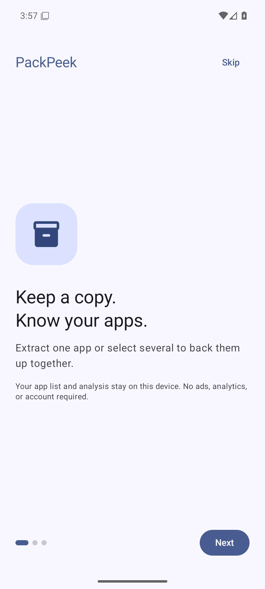
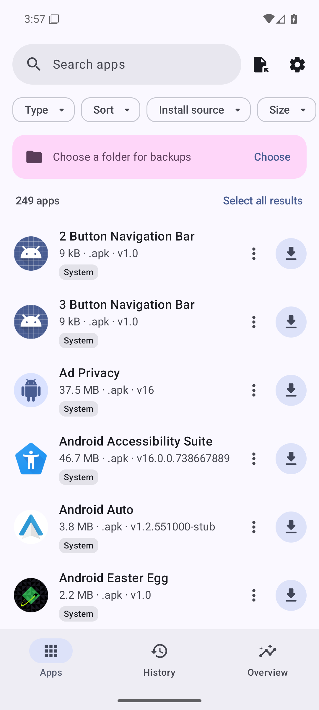
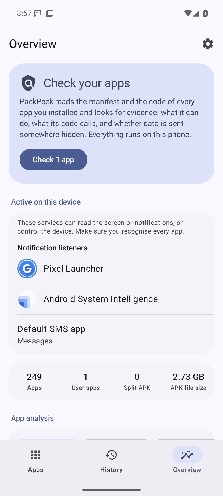
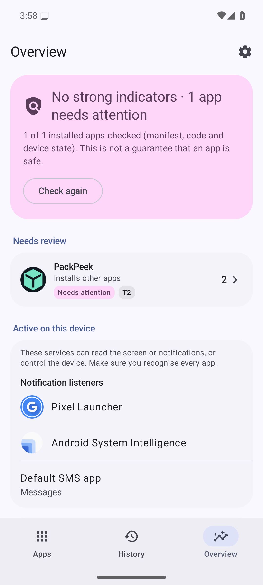
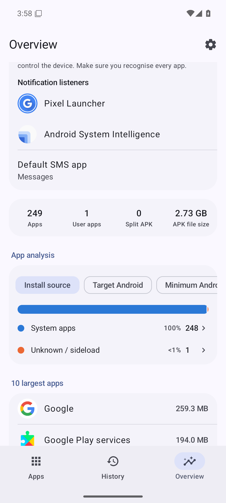
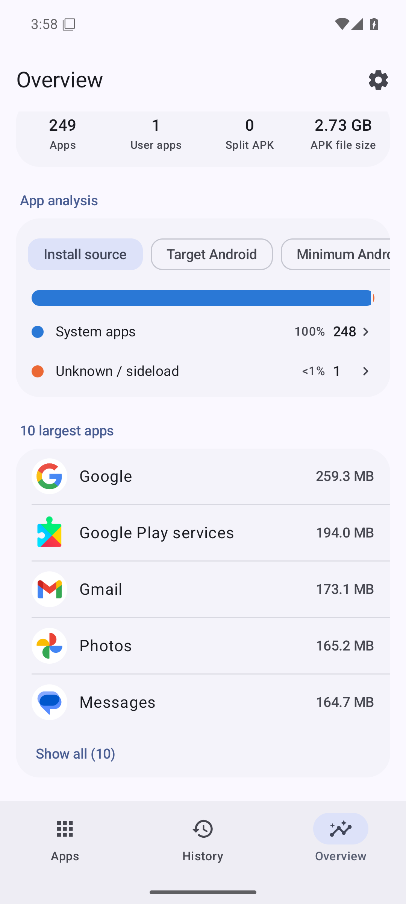

# PackPeek emulator run

Android 16 (API 36) · 2026-10-10 15:56 UTC

| # | Step | Result |
|---|---|---|
| 1 | Install PackPeek | ✅ |
| 2 | Copy undangan-sim.apk to Download | ✅ |
| 3 | Launch | ✅ |
| 4 | Onboarding shown | ✅ |
| 5 | App list loads | ✅ |
| 6 | Open Overview | ✅ |
| 7 | Check card shown | ✅ |
| 8 | Start the app check | ✅ |
| 9 | Check finishes | ✅ |
| 10 | Back to the app list | ✅ |
| 11 | Open the file picker | ⚠️ skipped |
| 12 | No crash | ✅ |

## Screenshots

### 1. Onboarding

### 2. App list

### 3. Overview before the check

### 4. Overview after the check

### 5. Needs review and analysis

### 6. App analysis

