# PackPeek emulator run

Android 16 (API 36) · 2026-10-10 17:07 UTC

| # | Step | Result |
|---|---|---|
| 1 | Install PackPeek | ✅ |
| 2 | Copy undangan-sim.apk to Download | ✅ |
| 3 | Launch | ✅ |
| 4 | Onboarding shown | ✅ |
| 5 | App list loads | ✅ |
| 6 | Open Overview | ✅ |
| 7 | Check card shown | ✅ |
| 8 | Start the app check | ✅ |
| 9 | Check finishes | ✅ |
| 10 | Open undangan-sim.apk with the file picker | ✅ |
| 11 | Sample analysed | ✅ |
| 12 | Deep analysis finishes | ✅ |
| 13 | Report PDF reaches the share sheet | ❌ |
| 14 | Open control-clean.apk (picker not recognised, opened by VIEW intent) | ✅ |
| 15 | System install prompt | ❌ |
| 16 | No crash | ✅ |

## Screenshots

### 1. Onboarding

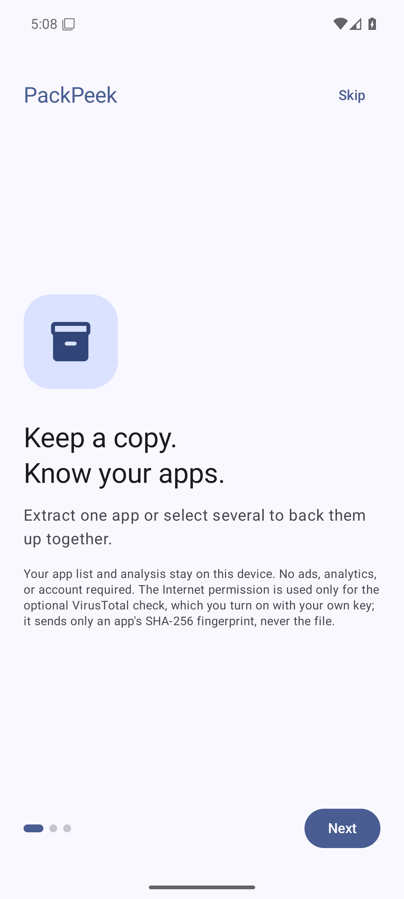

### 2. App list

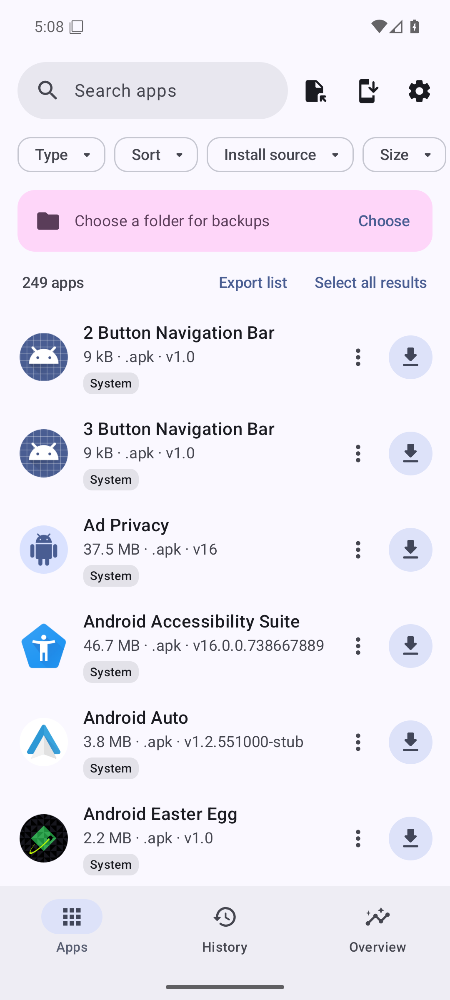

### 3. Overview before the check

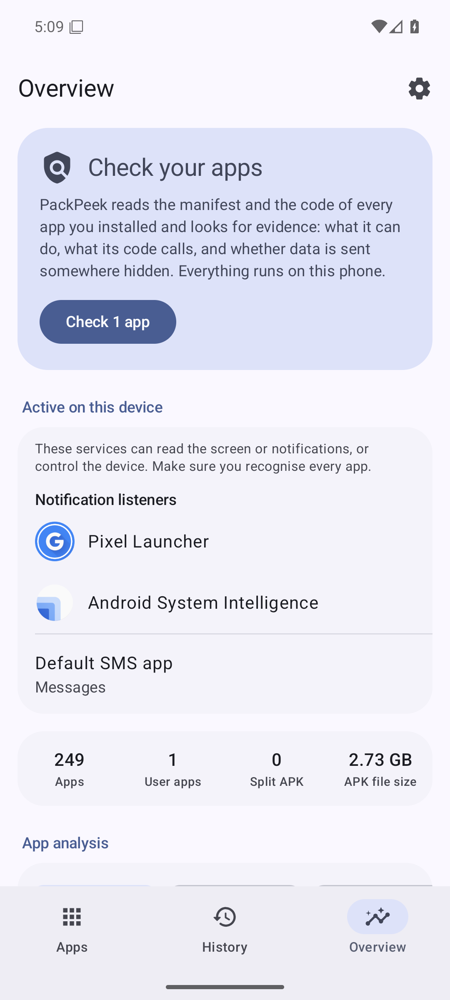

### 4. Overview after the check

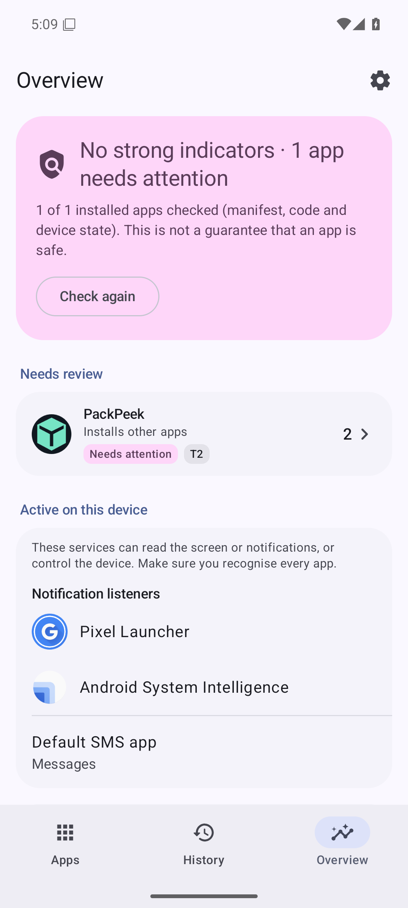

### 5. Needs review and analysis

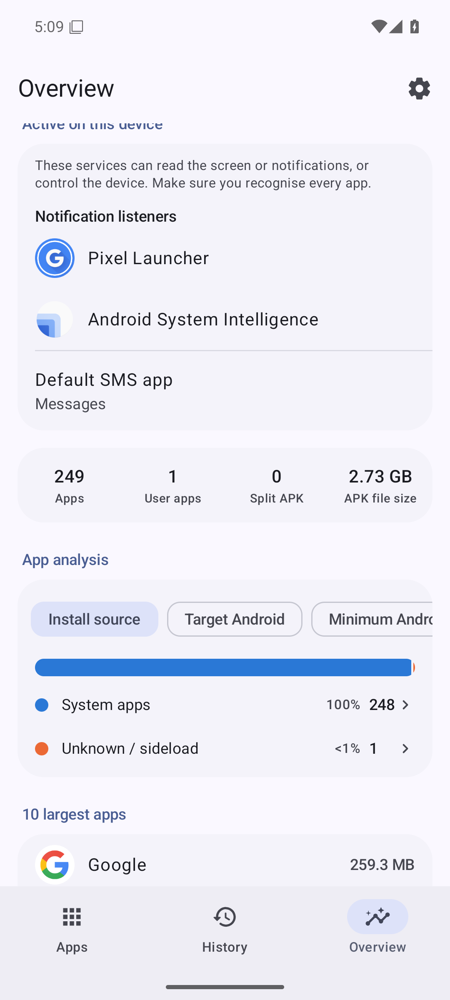

### 6. App analysis

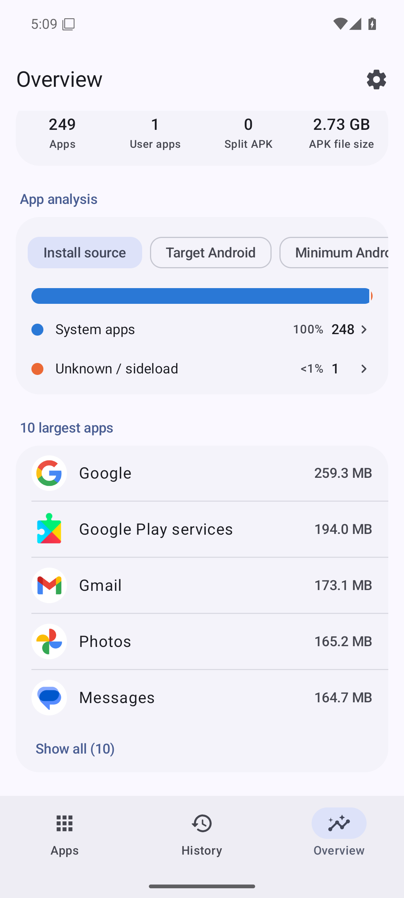

### 7. undangan-sim: concerns

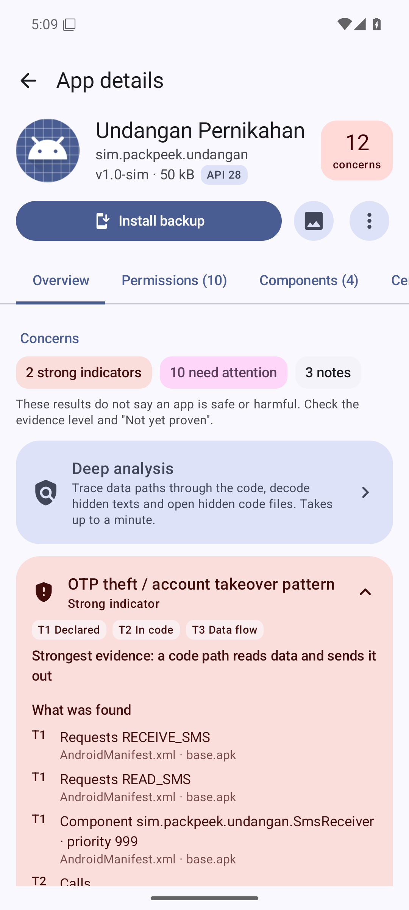

### 8. undangan-sim: evidence

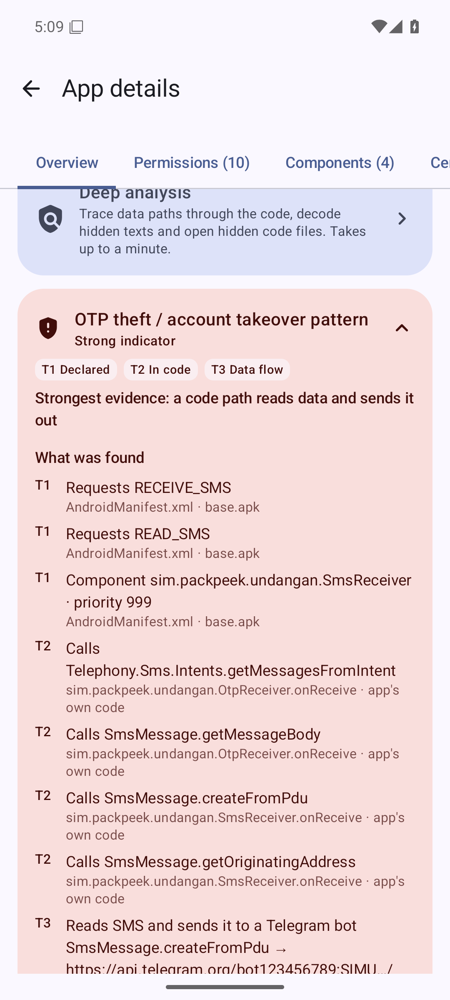

### 9. Deep analysis

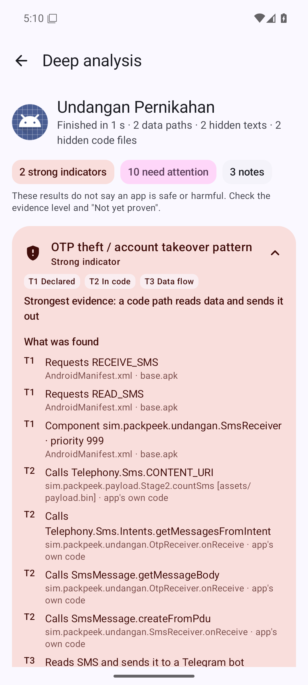

### 10. Deep analysis, part 1

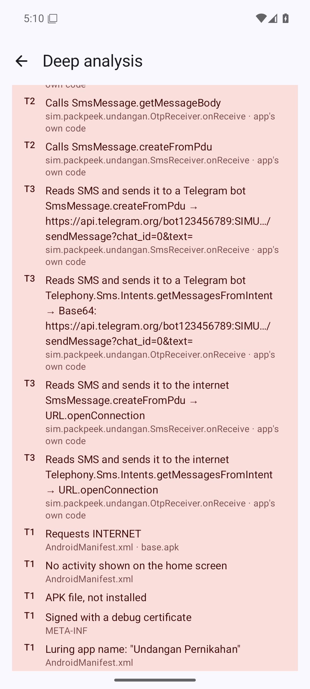

### 11. Deep analysis, part 2

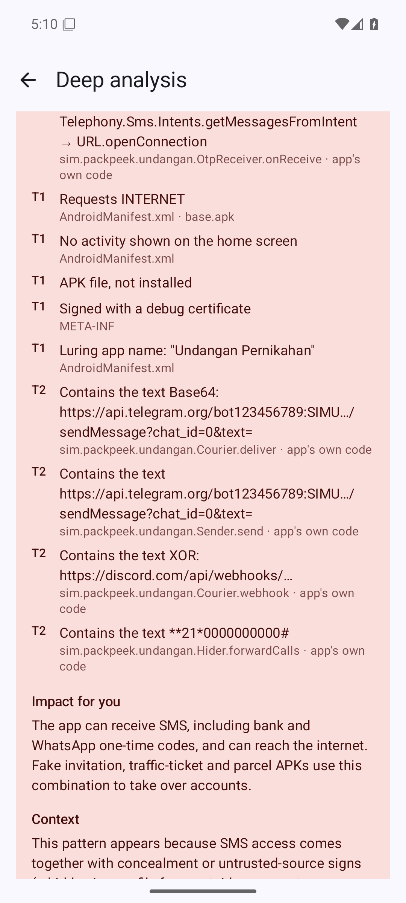

### 12. Deep analysis, part 3

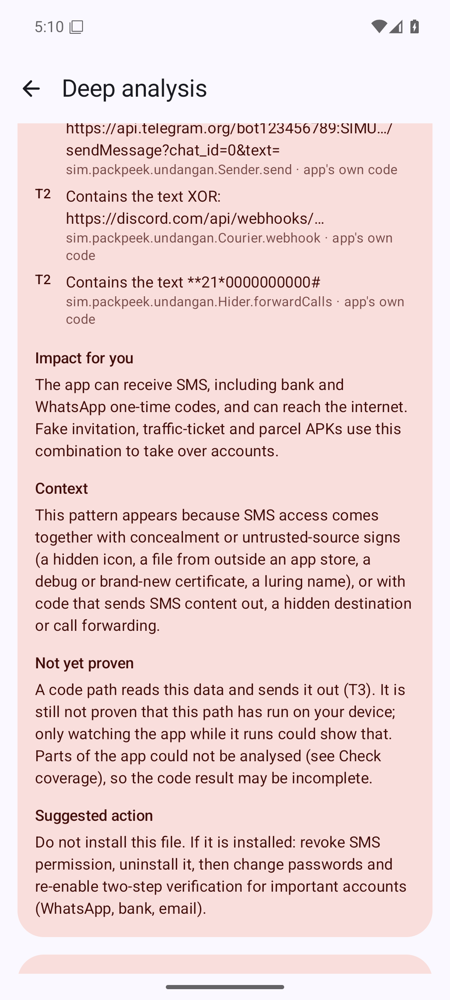

### 13. control-clean: ready to install

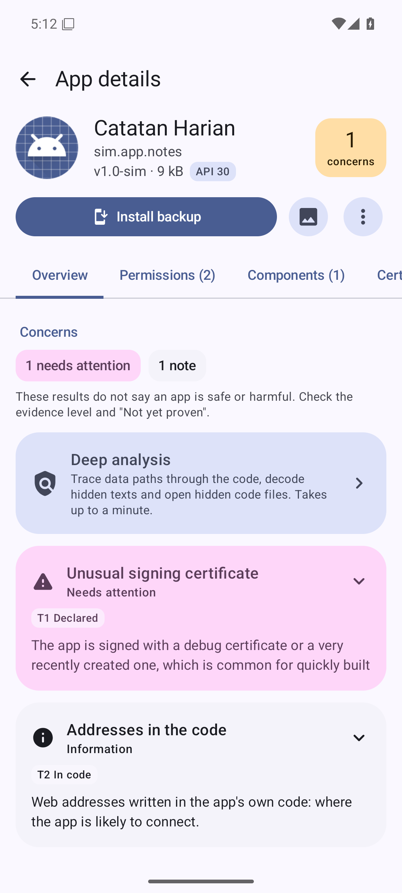
